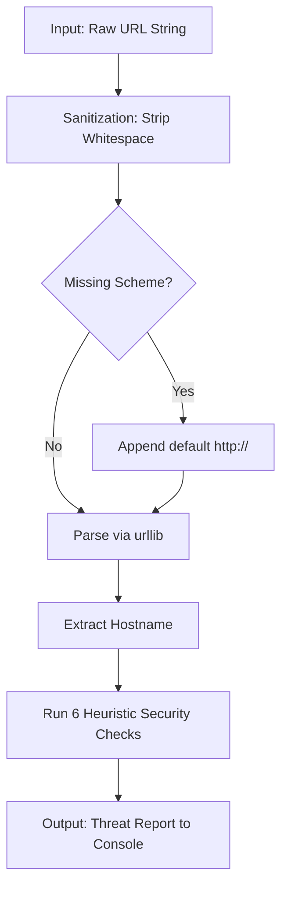
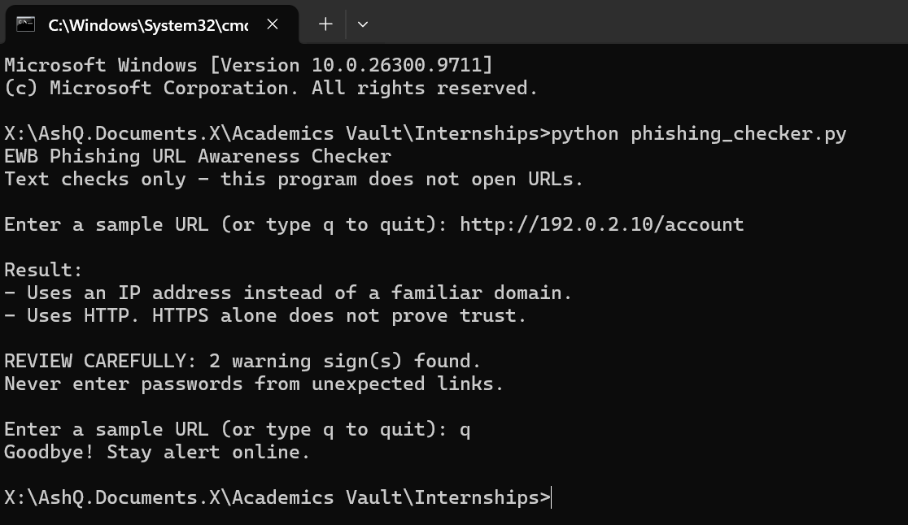
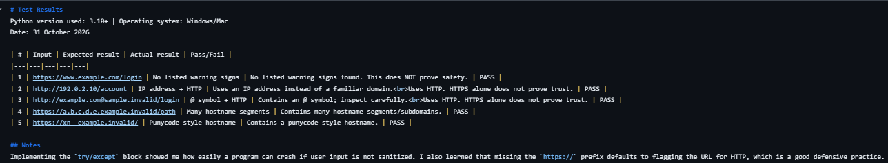

<div align="center">

# Ewb CyberSecurity Internship - Project

**Read the link. Spot the clues. Stay alert.**


🔍 Reads the **text** of a URL and points out warning signs. It never opens the link.


</div>


- **Name:** Ashish Kumar
- **College:** Jai Narain College of Technology, Bhopal
- **Batch:** October 2026
- **Project Title:** Phishing URL Awareness Checker
- **Completion Date:** 30 October, 2026
- **Mail:** kr.ashish535.hd@gmail.com


### 📎 Academic Deliverables

> **[📄 CLICK HERE TO VIEW: EWB Assessment 01 - Security Foundations (PDF)](./EWB_Cyber_Assessment01_Ashish_Kumar.pdf)**
> *This link directly opens my accompanying theoretical cybersecurity assessment included in this repository.*
---

### 📖 Executive Summary

Phishing remains a primary vector for credential theft and network compromise. This project serves as a first-line educational defense mechanism. It is a Python-based command-line interface (CLI) that parses raw URL strings and runs heuristic checks to identify common obfuscation techniques used by threat actors.
Security Guarantee: This tool operates entirely on local string manipulation. It makes zero HTTP/DNS network requests, ensuring malicious payloads are never accidentally executed or visited.


---

## ⚡ Quick Start
```text
py phishing_checker.py
```
Then type a sample URL such as `http://192.0.2.10/account` and press Enter. Type `q` to quit.


## ✨ Core Threat Detection Features

- 🔸 Credential Embedding (`@`): Flags URLs attempting to mask the true destination domain (e.g., `http://legit.com@malicious.com`).
- 📏 Length Obfuscation: Detects URLs exceeding 100 characters, a tactic used to push the true domain out of the user's visible address bar.
- 🔢 Raw IP Routing: Flags the use of direct IPv4 addresses instead of registered domain names.
- 🌐 Subdomain Stacking: Identifies excessive hostname segmentation (5+ parts) often used to mimic trusted brands.
- 🔤 Punycode Deception: Detects `xn--` prefixes, indicating an Internationalized Domain Name (IDN) potentially used for homograph attacks.
- 🔓 Unencrypted Protocols: Warns users when the deprecated, plaintext `HTTP` scheme is used.
- 🔁 Loop mode: check several URLs in one run, type q to quit
- ⚠️ "REVIEW CAREFULLY" summary with the number of warning signs found.
  

## 🔄 Technical Architecture



The program only handles text. It has no network code, so it cannot visit a URL.


## 🚩 The Six Warning Signs

| # | Warning sign | Why it matters |
|---|---|---|
| 1 | 🔸 `@` symbol | The browser ignores the text before `@`, so a link can look like one site but go to another |
| 2 | 📏 URL longer than 100 characters | Long links can hide the real destination |
| 3 | 🔢 IP address as hostname | Real brands normally use names, not numbers |
| 4 | 🌐 5 or more hostname segments | Stacked names can make a link look official |
| 5 | 🔤 `xn--` punycode marker | Can hide look-alike foreign letters |
| 6 | 🔓 HTTP instead of HTTPS | HTTP is not encrypted |

<details>
<summary>🤔 Why is "no warning signs" not the same as "safe"?</summary>

These are clues, not proof. A link with zero clues can still be dangerous, for example a name with a slightly wrong spelling. A link with clues can also be harmless. This tool checks only six clues, so it can never prove that a URL is safe.

</details>


## 🗂️ Project Structure
```text
phishing-url-awareness/
├── phishing_checker.py                        # the Python program
├── README.md                                  # this file
├── requirements.txt                           # no extra packages needed
├── EWB_Cyber_Assessment01_Ashish_Kumar.pdf    # Assessment 01: Security Foundations
├── tests/
│   └── test_samples.md                        # test evidence table
└── screenshots/
    ├── sample_run.png                         # one program run
    └── test_results.png                       # proof of the tests
```


## 📦 Requirements
Python 3.10 or later. No extra packages.

## ▶️ Quick Start Guide
Windows: `py phishing_checker.py` (or `python phishing_checker.py`)

Mac/Linux: `python3 phishing_checker.py`


## 💻 Console Demonstration
```text
EWB Phishing URL Awareness Checker
Text checks only - this program does not open URLs.

Enter a sample URL (or type q to quit): http://192.0.2.10/account

Result:
- Uses an IP address instead of a familiar domain.
- Uses HTTP. HTTPS alone does not prove trust.

REVIEW CAREFULLY: 2 warning sign(s) found.
Never enter passwords from unexpected links.

Enter a sample URL (or type q to quit): q
Goodbye! Stay alert online.
```


## 🎯 Try It Yourself
Use only these sample strings. They use reserved example-style domains and documentation IP space.

| Type this | You should see |
|---|---|
| `https://www.example.com/login` | No listed warning signs found |
| `http://192.0.2.10/account` | IP address + HTTP warnings |
| `http://example.com@sample.invalid/login` | @ symbol + HTTP warnings |
| `https://a.b.c.d.e.example.invalid/path` | Many hostname segments warning |
| `https://xn--example.invalid/` | Punycode-style hostname warning |


## 🧪 Testing
Full table is in `tests/test_samples.md`.

| # | Input | Expected | Actual | Result |
|---|-------|----------|--------|--------|
| 1 | `https://www.example.com/login` | No warning signs | No listed warning signs found. This does NOT prove safety. | ✅ PASS |
| 2 | `http://192.0.2.10/account` | IP address + HTTP | IP address and HTTP warnings shown | ✅ PASS |
| 3 | `http://example.com@sample.invalid/login` | @ symbol + HTTP | @ symbol and HTTP warnings shown | ✅ PASS |
| 4 | `https://a.b.c.d.e.example.invalid/path` | Many hostname segments | Many hostname segments warning shown | ✅ PASS |
| 5 | `https://xn--example.invalid/` | Punycode-style hostname | Punycode-style hostname warning shown | ✅ PASS |


## 📸 Execution Evidence
**Sample run**



**Test results**




## 🚀 Developer Enhancements (Beyond Base Requirements)
To elevate the baseline project, I engineered the following improvements:

 **1.** Continuous Execution Loop (`while True`):
The Upgrade: Transitioned the script from a single-execution model to a continuous session. Users can evaluate bulk URLs rapidly and gracefully terminate the process using standard exit commands (`q`, `quit`, `exit`).

 **2.** Dynamic Threat Summarization (`has_warnings()`):
The Upgrade: Implemented a boolean helper function to distinguish between benign system messages and actual security flags. If true threats are detected, it dynamically renders a `REVIEW CAREFULLY: [X] warning sign(s) found` alert to improve user visibility.

 **3.** Exception Handling for Malformed Syntax:
The Upgrade: Wrapped the `urllib.parse` engine in a `try/except` block targeting `ValueErrors`. This prevents terminal crashes when users input intentionally broken or invalid IPv6 structures (e.g., `http://[bad`).


## ⚠️ Scope & Limitations

This repository is an educational prototype. It performs static text analysis only. A URL returning "zero warnings" does not cryptographically or empirically guarantee safety. Threat actors frequently compromise legitimate domains that will bypass all text-based heuristic checks. Always utilize comprehensive reputation scanners (e.g., VirusTotal) for real-world incidents.


## 🤝 Ethical Use
Use sample strings only. Do not collect credentials. Do not use this
project to deceive anyone or to test websites without permission.


## 📎 Additional Document
This repository also includes `EWB_Cyber_Assessment01_Ashish_Kumar.pdf`, my EWB Assessment 01 (Security Foundations), uploaded as instructed by the EWB team. It is separate from the Phishing URL Awareness Checker mini project.


## 👤 Author
Ashish Kumar
<div align="center">
<i>Built securely and ethically for the EWB AI-Powered Cybersecurity Internship.</i>
</div>
